<div align="center">

# 🔥 KaloriTakip

**Yapay zekâ ile yemek fotoğrafından kalori hesaplayan, beslenme ve kilo takibi yapan mobil uygulama**
<br>Flutter (iOS + Android) · Laravel 11 API + Admin Panel · MySQL · OpenRouter · RevenueCat


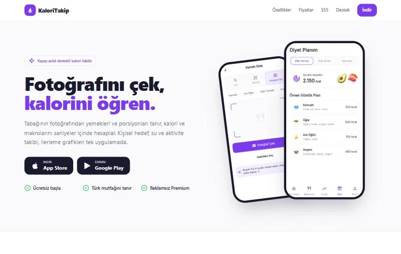

</div>

---

## İçindekiler

- [Özellikler](#-özellikler)
- [Ekran görüntüleri](#-ekran-görüntüleri)
- [Mimari](#-mimari)
- [Klasör yapısı](#-klasör-yapısı)
- [Gereksinimler](#-gereksinimler)
- [Kurulum — Backend ve Admin Panel](#-kurulum--backend-ve-admin-panel)
- [Kurulum — Mobil Uygulama](#-kurulum--mobil-uygulama)
- [Yapay zekâ (OpenRouter)](#-yapay-zekâ-openrouter)
- [Abonelik ve ödeme (RevenueCat)](#-abonelik-ve-ödeme-revenuecat)
- [Admin paneli kullanımı](#-admin-paneli-kullanımı)
- [Gelir – gider dengesi](#-gelir--gider-dengesi)
- [Web sayfaları ve mağaza gereksinimleri](#-web-sayfaları-ve-mağaza-gereksinimleri)
- [Zamanlanmış görevler](#-zamanlanmış-görevler)
- [Testler](#-testler)
- [Yayına alma kontrol listesi](#-yayına-alma-kontrol-listesi)
- [API referansı](#-api-referansı)
- [Ortam değişkenleri](#-ortam-değişkenleri)
- [Sorun giderme](#-sorun-giderme)

---

## ✨ Özellikler

### Mobil uygulama (Flutter · iOS + Android)

| | |
|---|---|
| 📸 **Fotoğrafla AI analizi** | Tabağın fotoğrafından yemekleri, gramajları, kalori ve makroları tahmin eder. Gramaj düzenlenebilir, düşük güvenli tahminler işaretlenir. |
| 🔎 **Arama ve barkod** | Yerel yemek veritabanı + Open Food Facts üzerinden barkodlu paketli ürünler (bulunan ürün yerelde saklanır). |
| 🎯 **Kişisel hedef** | Mifflin‑St Jeor formülüyle günlük kalori, protein/karbonhidrat/yağ ve su hedefi. |
| 🍽️ **Öğün günlüğü** | Kahvaltı · ara öğün · öğle · ara öğün · akşam; geçmiş günlere ekleme, silme. |
| 📈 **İlerleme** | Kilo grafiği, hedefe ilerleme ve tahmini varış tarihi, kalori grafiği, makro ortalaması, kayıt serisi. |
| 💧 **Su ve aktivite** | Tek dokunuşla su; MET formülüyle aktivite kalorisi (günlük bütçeye eklenir). |
| 🥗 **Diyet planları** | Hedefe göre örnek günlük planlar, premium planlar kilitli. |
| 👑 **Premium** | RevenueCat ile App Store / Google Play abonelikleri, deneme süresi, geri yükleme, abonelik yönetimi. |
| 🔒 **Hesap ve gizlilik** | Uygulama içinden hesap silme, yasal metin linkleri (App Store & Google Play zorunlulukları). |

### Admin panel (Laravel + Inertia + Vue 3 + Tailwind)

- **Genel bakış:** gelir, toplam gider, net kâr, kâr marjı, **AI maliyeti / gelir oranı** uyarısı, günlük grafik, gider dağılımı, bugünkü AI bütçesi.
- **Kullanıcılar:** arama/filtre, elle premium verme/kaldırma, AI hakkı sıfırlama, engelleme, detay sayfası.
- **Yemek veritabanı:** CRUD, görsel yükleme (600×600 WebP), AI'dan öğrenilen yemekleri onaylama.
- **AI analizleri:** görsel, sonuç, model, token, süre ve **TL / USD maliyet**.
- **AI & Ayarlar:** OpenRouter anahtarı (şifreli saklanır, doğrulanarak kaydedilir), model yönetimi (ana/yedek), **fiyatların OpenRouter'dan otomatik çekilmesi**, kota & bütçe, **USD/TL kurunun TCMB'den otomatik takibi**.
- **Giderler:** sunucu, reklam vb. giderler → kârlılık hesabına girer.
- Açık / koyu tema, mobil uyumlu.

### Web

- Tanıtım sayfası (gerçek uygulama ekranlarıyla) ve politika sayfaları: Gizlilik, Kullanım Koşulları (EULA), Abonelik Koşulları, KVKK, Hesap Silme, Destek.

---

## 📱 Ekran görüntüleri

### Mobil uygulama

| Ana Sayfa | Fotoğraf (AI) | Yemek Arama | Beslenme |
|:---:|:---:|:---:|:---:|
| 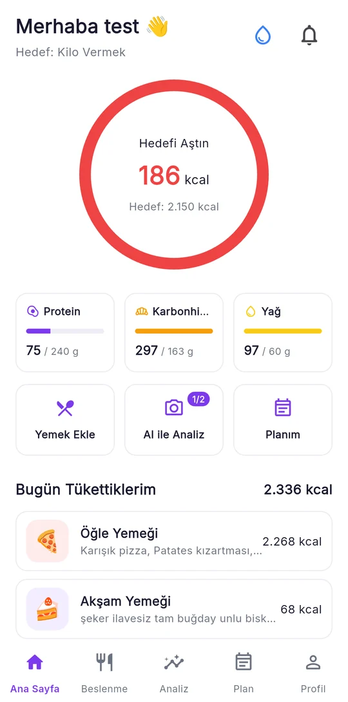 | 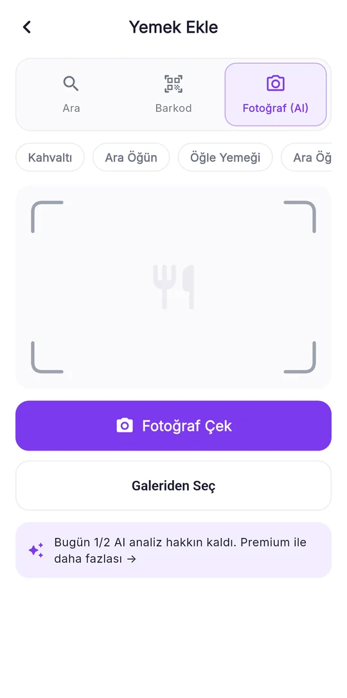 | 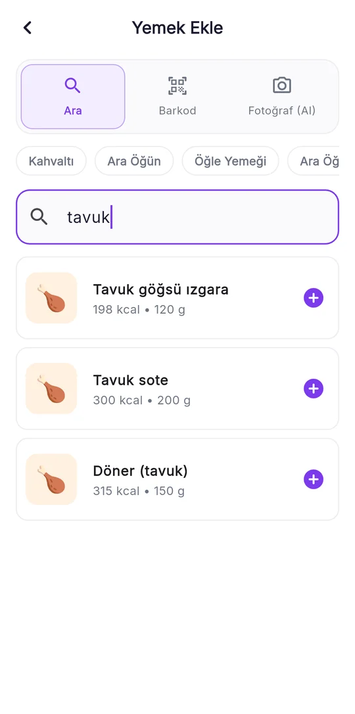 | 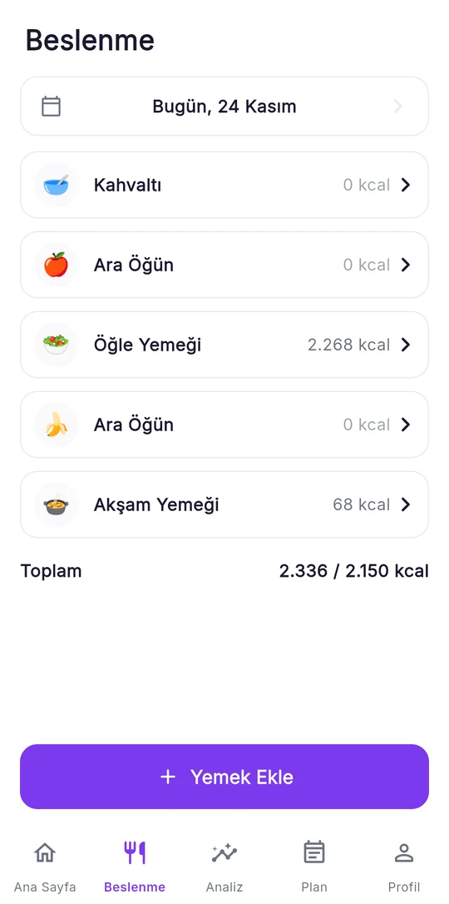 |

| İlerleme | Diyet Planım | Profil |
|:---:|:---:|:---:|
| 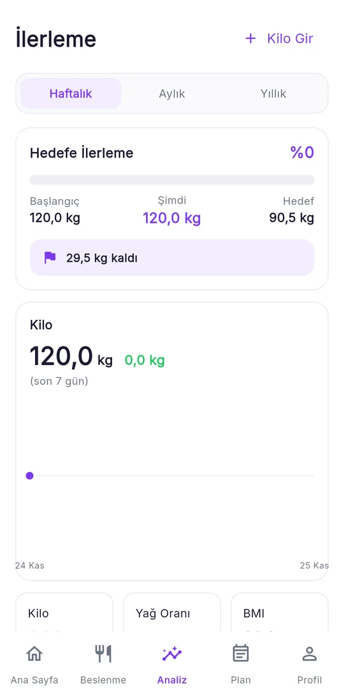 | 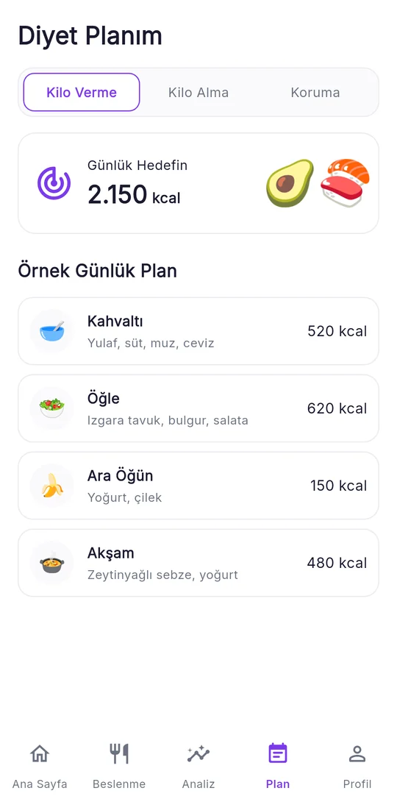 | 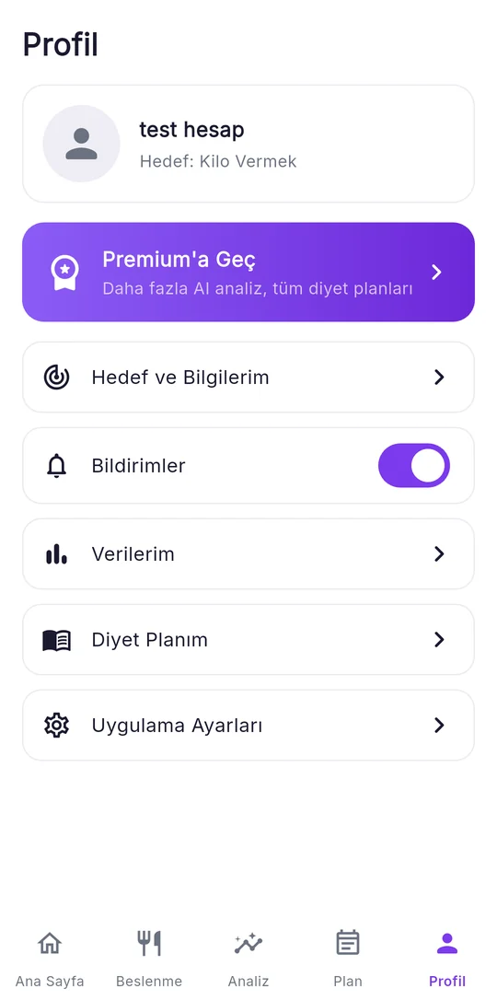 |

### Admin panel

| Genel Bakış | Kullanıcılar ve AI |
|:---:|:---:|
| 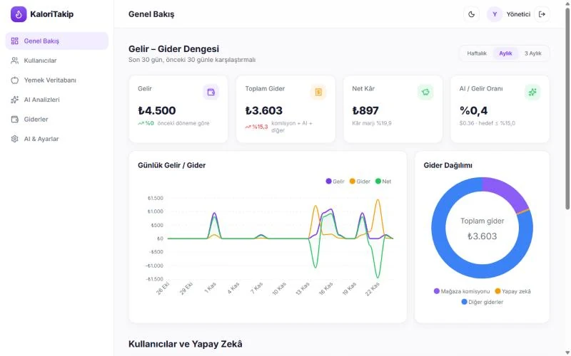 | 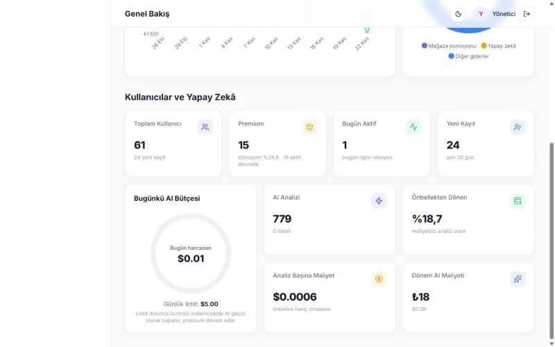 |
| **Kullanıcılar** | **Yemek Veritabanı** |
| 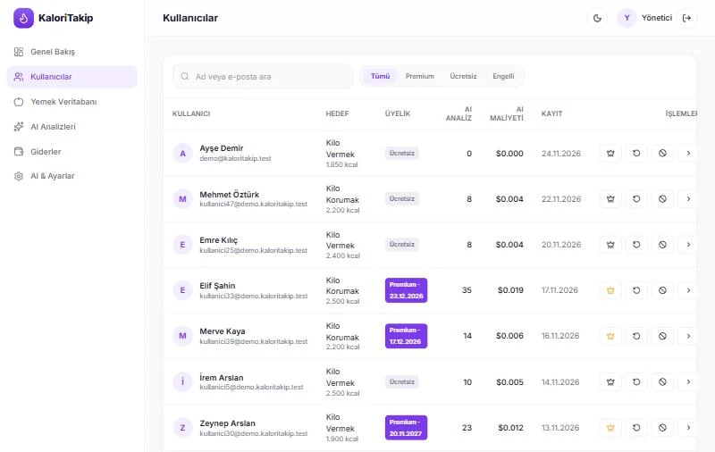 | 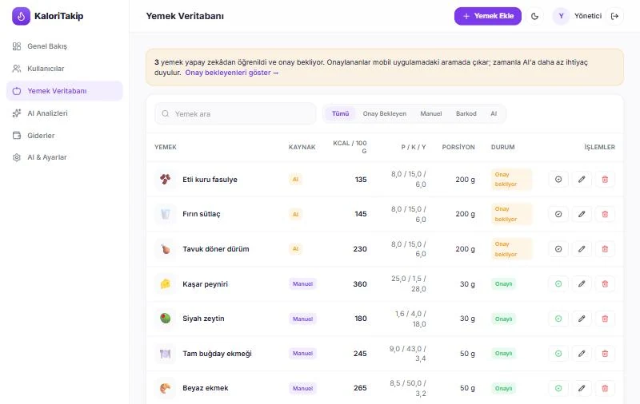 |
| **AI Analizleri** | **AI & Ayarlar** |
| 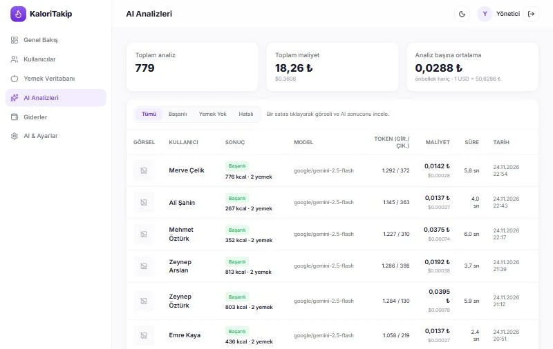 | 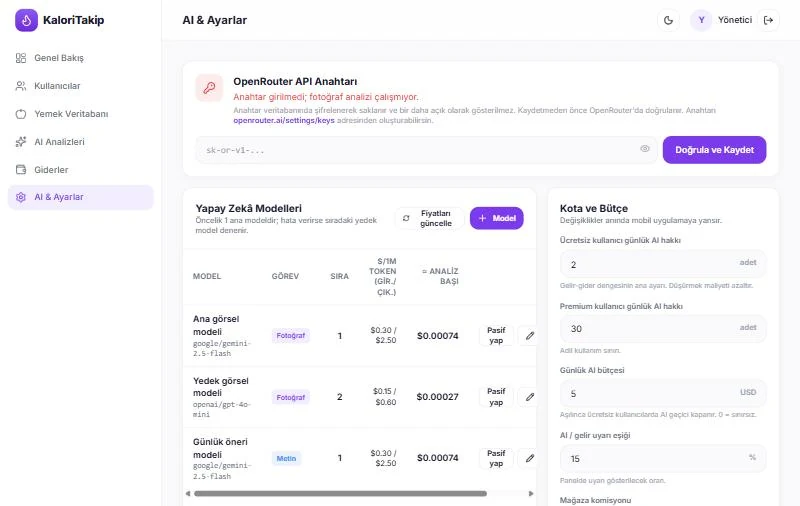 |
| **Giderler** | **Giriş** |
| 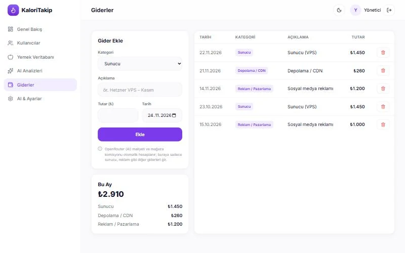 | 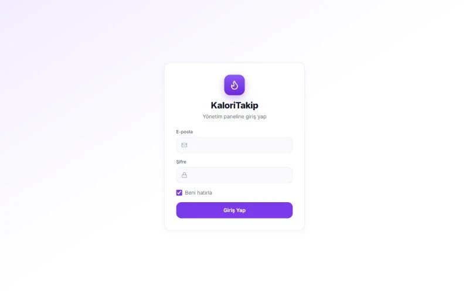 |

> Admin ekran görüntüleri `DemoSeeder` ile oluşturulan örnek verilerle alınmıştır (bkz. [Demo veri](#demo-veri)).

---

## 🏗 Mimari

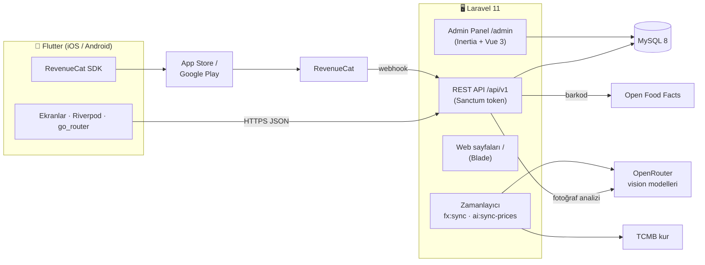

**Önemli tasarım kararları**

- OpenRouter anahtarı **asla mobil uygulamada değildir**; tüm AI çağrıları backend üzerinden yapılır. Böylece kota, bütçe ve maliyet sunucuda kontrol edilir.
- Fotoğraf hem cihazda (image_picker) hem sunucuda **1024 px'e küçültülür** → AI maliyetinin ana etkeni.
- Aynı fotoğraf tekrar gelirse **önbellekten** döner (maliyet 0, hak düşmez).
- Ana model hata verirse **yedek model** otomatik denenir.
- Gerçek maliyet her istekte OpenRouter'ın `usage.cost` değerinden kaydedilir.

---

## 📁 Klasör yapısı

```
kaloritakip/
├── backend/                     Laravel 11 — API, admin panel, web sayfaları
│   ├── app/
│   │   ├── Http/Controllers/
│   │   │   ├── Api/V1/          Mobil API (auth, dashboard, foods, meals, ai, progress, …)
│   │   │   ├── Admin/           Admin panel (Inertia)
│   │   │   └── SiteController   Tanıtım + politika sayfaları
│   │   ├── Services/
│   │   │   ├── Ai/              OpenRouterClient, FoodPhotoAnalyzer, AiQuota, OpenRouterCatalog, AiCredentials
│   │   │   ├── NutritionCalculator, ProfitabilityService, ProgressInsights,
│   │   │   └── SubscriptionService, ExchangeRateService
│   │   └── Console/Commands/    ai:sync-prices, fx:sync
│   ├── database/
│   │   ├── migrations/
│   │   └── seeders/             DatabaseSeeder, FoodSeeder, DemoSeeder
│   ├── resources/
│   │   ├── js/                  Admin panel (Vue 3 sayfaları, bileşenler)
│   │   └── views/site/          Tanıtım + politika sayfaları (Blade)
│   ├── routes/                  api.php · web.php · console.php
│   └── tests/Feature/           58 test
├── mobile/                      Flutter uygulaması
│   ├── lib/
│   │   ├── core/                tema, router, API istemcisi, linkler
│   │   ├── shared/              ortak widget'lar (buton, kart, halka, görsel)
│   │   └── features/            auth, onboarding, home, add_food, nutrition,
│   │                            progress, diet_plan, water_activity, profile, premium
│   └── test/                    33 test
├── docs/screenshots/            README görselleri
└── PLAN.md                      Proje planı
```

---

## 🧰 Gereksinimler

| Araç | Sürüm | Not |
|---|---|---|
| PHP | 8.2+ | `pdo_mysql`, `gd` (WebP desteğiyle), `intl`, `zip`, `mbstring` |
| Composer | 2.x | |
| Node.js | 20+ | Admin panel derlemesi |
| MySQL / MariaDB | 8.0+ / 10.6+ | XAMPP, Laragon, Docker… |
| Flutter | 3.44+ (Dart 3.12+) | `flutter doctor` temiz olmalı |
| Android Studio / SDK | API 34+ | Android derlemesi |
| Xcode | 15+ (macOS) | **iOS derlemesi yalnızca macOS'ta** (veya Codemagic vb.) |

---

## 🚀 Kurulum — Backend ve Admin Panel

### 1. Bağımlılıklar

```bash
cd backend
composer install
npm install
```

### 2. Ortam dosyası

```bash
cp .env.example .env
php artisan key:generate
```

`.env` içinde en az şunları doldurun:

```dotenv
APP_URL=http://localhost:8000

DB_CONNECTION=mysql
DB_HOST=127.0.0.1
DB_PORT=3306
DB_DATABASE=kaloritakip
DB_USERNAME=root
DB_PASSWORD=

# İlk admin hesabı (seed sırasında oluşturulur)
ADMIN_EMAIL=admin@ornek.com
ADMIN_PASSWORD=guclu-bir-sifre
```

> Tüm değişkenler için bkz. [Ortam değişkenleri](#-ortam-değişkenleri).

### 3. Veritabanı

```bash
# MySQL'de veritabanını oluşturun
mysql -uroot -e "CREATE DATABASE kaloritakip CHARACTER SET utf8mb4 COLLATE utf8mb4_unicode_ci;"

php artisan migrate --seed      # tablolar + admin + 45 temel yemek + AI modelleri + aktiviteler + diyet planları
php artisan storage:link        # yemek görselleri için
```

### 4. Admin panel derlemesi ve çalıştırma

```bash
npm run build                   # geliştirmede canlı yenileme için: npm run dev
php artisan serve --host=0.0.0.0 --port=8000
```

| Adres | İçerik |
|---|---|
| http://localhost:8000 | Tanıtım sayfası |
| http://localhost:8000/admin | **Admin panel** (`.env`'deki `ADMIN_EMAIL` / `ADMIN_PASSWORD`) |
| http://localhost:8000/api/v1 | Mobil API |

### 5. İlk ayarlar (admin panel → **AI & Ayarlar**)

1. **OpenRouter API anahtarını** girin → *Doğrula ve Kaydet*.
2. **Fiyatları güncelle** butonuna basın (model fiyatları OpenRouter'dan çekilir).
3. **USD/TL kuru** "Otomatik" açık kalsın (TCMB'den çekilir).
4. Ücretsiz/premium günlük AI hakkını ve günlük AI bütçesini belirleyin.

### Demo veri

Paneli ve uygulamayı dolu görmek için **ayrı bir demo veritabanında**:

```bash
mysql -uroot -e "CREATE DATABASE kaloritakip_demo CHARACTER SET utf8mb4 COLLATE utf8mb4_unicode_ci;"
DB_DATABASE=kaloritakip_demo php artisan migrate --seed
DB_DATABASE=kaloritakip_demo php artisan db:seed --class=DemoSeeder
DB_DATABASE=kaloritakip_demo php artisan serve --port=8001
```

PowerShell'de: `$env:DB_DATABASE='kaloritakip_demo'; php artisan serve --port=8001`

- 60 demo kullanıcı, ~%33'ü premium, 60 günlük abonelik geliri, ~780 AI analizi ve giderler
- Mobil test hesabı: **`demo@kaloritakip.test` / `demo12345`** (21 günlük öğün, kilo, su ve aktivite geçmişi)
- `DemoSeeder` `APP_ENV=production` iken çalışmaz.

---

## 📲 Kurulum — Mobil Uygulama

### 1. Bağımlılıklar

```bash
cd mobile
flutter pub get
```

### 2. Derleme parametreleri (`--dart-define`)

| Parametre | Zorunlu | Açıklama | Örnek |
|---|---|---|---|
| `API_URL` | ✅ | Backend API adresi | `https://api.kaloritakip.app/api/v1` |
| `WEB_URL` | | Politika sayfalarının adresi (verilmezse `API_URL`'den türetilir) | `https://kaloritakip.app` |
| `RC_ANDROID_KEY` | Satın alma için | RevenueCat Google Play public SDK anahtarı | `goog_xxx` |
| `RC_IOS_KEY` | Satın alma için | RevenueCat App Store public SDK anahtarı | `appl_xxx` |

> RevenueCat anahtarı verilmezse Premium ekranı **önizleme modunda** açılır (örnek fiyatlar, satın alma kapalı).

### 3. Android'de çalıştırma

**Emülatör** (bilgisayardaki backend'e `10.0.2.2` ile ulaşır):

```bash
flutter run --dart-define=API_URL=http://10.0.2.2:8000/api/v1
```

**USB ile bağlı gerçek telefon** (önerilen — IP gerektirmez):

```bash
adb reverse tcp:8000 tcp:8000
flutter run --dart-define=API_URL=http://127.0.0.1:8000/api/v1
```

**Aynı Wi‑Fi'deki telefon:**

```bash
flutter run --dart-define=API_URL=http://192.168.1.20:8000/api/v1   # bilgisayarın yerel IP'si
```

> Debug derlemesinde yerel `http` bağlantısına izin verilir (`android/app/src/debug/AndroidManifest.xml`). Release derlemesi yalnızca HTTPS kullanır.

### 4. iOS'ta çalıştırma (macOS)

```bash
cd mobile
flutter pub get
open ios/Runner.xcworkspace
```

Xcode'da:

1. **Signing & Capabilities** → Team seçin, Bundle ID'yi (`com.kaloritakip.kaloritakip`) kendi kimliğinizle değiştirin.
2. **+ Capability → In-App Purchase** ekleyin.
3. Simülatörde: `flutter run --dart-define=API_URL=http://127.0.0.1:8000/api/v1`

`Info.plist`'te hazır olanlar: kamera/fotoğraf izin metinleri, `ITSAppUsesNonExemptEncryption=false`, yerel ağ izni (`NSAllowsLocalNetworking`), minimum iOS 13.

### 5. Mağaza derlemeleri

```bash
# Android App Bundle (Google Play)
flutter build appbundle --release \
  --dart-define=API_URL=https://api.kaloritakip.app/api/v1 \
  --dart-define=WEB_URL=https://kaloritakip.app \
  --dart-define=RC_ANDROID_KEY=goog_xxx

# iOS (macOS)
flutter build ipa --release \
  --dart-define=API_URL=https://api.kaloritakip.app/api/v1 \
  --dart-define=WEB_URL=https://kaloritakip.app \
  --dart-define=RC_IOS_KEY=appl_xxx
```

> Android imzalama: `android/key.properties` + keystore oluşturun ([Flutter belgesi](https://docs.flutter.dev/deployment/android#sign-the-app)). Bu dosyalar `.gitignore` kapsamındadır, **repoya eklemeyin**.

---

## 🤖 Yapay zekâ (OpenRouter)

1. [openrouter.ai](https://openrouter.ai) hesabı açın, kredi yükleyin, [anahtar oluşturun](https://openrouter.ai/settings/keys).
2. Admin panel → **AI & Ayarlar** → anahtarı yapıştırın → *Doğrula ve Kaydet*
   (alternatif: `.env` → `OPENROUTER_API_KEY`; paneldeki anahtar önceliklidir).
3. **Modeller:** *+ Model* penceresinde OpenRouter'da arama yapın; görev "Fotoğraf" iken yalnızca görsel okuyabilen modeller, ucuzdan pahalıya listelenir. Seçince fiyatlar otomatik dolar.
   - Öncelik **1** = ana model, **2+** = yedek (ana model hata verirse sırayla denenir).
   - Ücretsiz (`:free`) modelleri ana model yapmayın; istek limitleri çok düşüktür.

**Maliyet koruması**

| Mekanizma | Nerede |
|---|---|
| Kullanıcı başı günlük AI hakkı (ücretsiz / premium) | AI & Ayarlar → Kota ve Bütçe |
| Günlük toplam AI bütçesi (aşılınca ücretsiz kullanıcılarda AI geçici kapanır) | AI & Ayarlar |
| Aynı fotoğraf önbelleği | otomatik |
| AI'dan öğrenilen yemekler → onaylanınca aramada çıkar (zamanla daha az AI çağrısı) | Yemek Veritabanı |
| Dakikada en fazla 6 analiz isteği | API rate limit |

---

## 💳 Abonelik ve ödeme (RevenueCat)

1. **Mağaza ürünleri**
   - Google Play Console ve App Store Connect'te iki otomatik yenilenen abonelik: `premium_monthly`, `premium_annual` (yıllığa 7 gün ücretsiz deneme önerilir).
2. **RevenueCat** ([revenuecat.com](https://www.revenuecat.com))
   - Proje → App Store ve Play Store uygulamalarını bağlayın.
   - **Entitlement:** `premium` · **Offering (current):** `monthly` + `annual` paketleri.
   - **Webhook:** `https://ALANADINIZ/api/v1/webhooks/revenuecat` · *Authorization header* değerini belirleyin.
3. **Backend `.env`**
   ```dotenv
   REVENUECAT_WEBHOOK_SECRET="Bearer belirlediginiz-gizli-deger"   # RevenueCat'teki Authorization değeriyle birebir aynı
   REVENUECAT_SECRET_KEY=sk_xxx                                     # satın alma sonrası anında doğrulama için
   REVENUECAT_ENTITLEMENT=premium
   ```
4. **Mobil derleme:** `--dart-define=RC_ANDROID_KEY=goog_xxx` / `RC_IOS_KEY=appl_xxx`

**Akış:** Uygulama kullanıcıyı RevenueCat'te kendi kullanıcı id'mizle tanıtır → satın alma → uygulama `POST /subscription/sync` ile backend'e haber verir (premium anında açılır) → RevenueCat webhook'u yenileme/iptal/iade/süre dolması olaylarını işler → gelir `subscriptions` tablosuna TL olarak, mağaza komisyonu düşülerek yazılır.

| Olay | Sonuç |
|---|---|
| `INITIAL_PURCHASE`, `RENEWAL`, `PRODUCT_CHANGE`, `UNCANCELLATION` | Premium açılır/uzar, gelir kaydı |
| Deneme (`period_type=TRIAL`) | Premium açılır, gelir 0 |
| `CANCELLATION` | Dönem sonuna kadar premium sürer |
| `CANCELLATION` + `CUSTOMER_SUPPORT` (iade) | Premium hemen kapanır, kayıt `refunded` |
| `EXPIRATION` | Premium biter |

**Mağaza uyumu (paywall'da hazır):** abonelik adı/süresi/fiyatı, deneme koşulları, ödemenin Apple Kimliği/Google Play'den alınması, 24 saat kuralıyla otomatik yenileme metni, *Geri yükle*, *Kullanım Koşulları (EULA)* ve *Gizlilik* linkleri, premium kullanıcılara *Aboneliği Yönet*.

---

## 🛠 Admin paneli kullanımı

| Sayfa | Ne yapılır |
|---|---|
| **Genel Bakış** | Haftalık / aylık / 3 aylık gelir‑gider, net kâr, AI/gelir oranı uyarısı, kullanıcı ve AI istatistikleri |
| **Kullanıcılar** | Ara, filtrele (premium/ücretsiz/engelli), 30 gün premium ver/kaldır, günlük AI hakkını sıfırla, engelle (açık oturumlar kapanır) |
| **Yemek Veritabanı** | Yemek ekle/düzenle/sil, görsel yükle, AI'dan öğrenilen yemekleri onayla |
| **AI Analizleri** | Her analizin görseli, sonucu, modeli, token'ı, süresi ve TL/USD maliyeti |
| **Giderler** | Sunucu, depolama, reklam giderleri (AI ve mağaza komisyonu otomatik hesaplanır) |
| **AI & Ayarlar** | OpenRouter anahtarı, modeller ve fiyatlar, kota/bütçe, mağaza komisyonu, USD/TL kuru |

Admin hesabı eklemek için:

```bash
php artisan tinker --execute="App\Models\User::where('email','kisi@ornek.com')->update(['is_admin'=>true]);"
```

---

## 💰 Gelir – gider dengesi

**Kâr = Abonelik geliri − Mağaza komisyonu − AI maliyeti (USD × kur) − Diğer giderler**

| Ayar | Varsayılan | Etkisi |
|---|---|---|
| Ücretsiz günlük AI hakkı | 2 | Ücretsiz kullanıcı maliyetinin ana belirleyicisi |
| Premium günlük AI hakkı | 30 | Adil kullanım sınırı |
| Günlük AI bütçesi | $5 | Aşılınca ücretsiz kullanıcılarda AI durur |
| AI / gelir uyarı eşiği | %15 | Genel Bakış'ta uyarı |
| Mağaza komisyonu | %15 | App Store / Google Play küçük işletme oranı |

Tipik maliyet: 1024 px fotoğraf ≈ 1.100–1.300 giriş + 150–400 çıkış token → seçilen modele göre analiz başına **~$0.0003 – $0.003**.
Ayrıntılı iş modeli: [PLAN.md](PLAN.md).

---

## 🌐 Web sayfaları ve mağaza gereksinimleri

| Adres | Kullanım |
|---|---|
| `/` | Tanıtım sayfası (mağaza "pazarlama URL'si") |
| `/gizlilik` | **Gizlilik Politikası** — App Store Connect & Google Play'de zorunlu |
| `/kullanim-kosullari` | **Kullanım Koşulları (EULA)** — App Store abonelik uygulamalarında zorunlu |
| `/abonelik-kosullari` | Otomatik yenileme, iptal, iade, geri yükleme |
| `/kvkk` | KVKK Aydınlatma Metni |
| `/hesap-silme` | **Google Play "hesap silme URL'si"** zorunluluğu |
| `/destek` | Destek / iletişim (App Store "Support URL") |

Şirket bilgileri `.env` → `SITE_*` değişkenlerinden gelir. Metinler **demo şablondur**; yayından önce bir hukuk danışmanına kontrol ettirip `SITE_DEMO=false` yapın.

Mağaza formları için özet:

- **App Store "App Privacy":** Contact Info (e‑posta), Health & Fitness (kilo, beslenme), Photos (analiz), Purchases, Identifiers (kullanıcı id). *Tracking: Hayır.*
- **Google Play "Data safety":** aynı veri türleri; aktarımda şifreleme var; kullanıcı silme talep edebilir.
- Uygulama içi hesap silme: **Profil → Verilerim → Hesabımı ve verilerimi sil** (App Store 5.1.1(v)).

---

## ⏰ Zamanlanmış görevler

| Komut | Zaman | Görev |
|---|---|---|
| `php artisan fx:sync` | 09:05, 12:05, 16:05, 20:05 | USD/TL kurunu TCMB'den günceller (yedek: ExchangeRate‑API) |
| `php artisan ai:sync-prices` | 04:00 | Kayıtlı AI modellerinin fiyatlarını OpenRouter'dan günceller |

Sunucuda tek bir cron satırı yeterli:

```cron
* * * * * cd /var/www/kaloritakip/backend && php artisan schedule:run >> /dev/null 2>&1
```

Yerelde: `php artisan schedule:work`

---

## 🧪 Testler

```bash
# Backend (ayrı test veritabanı kullanır: kaloritakip_test)
mysql -uroot -e "CREATE DATABASE kaloritakip_test CHARACTER SET utf8mb4 COLLATE utf8mb4_unicode_ci;"
cd backend && php artisan test

# Mobil
cd mobile && flutter analyze && flutter test
```

Dış servisler (OpenRouter, RevenueCat, Open Food Facts, TCMB) testlerde `Http::fake` ile taklit edilir; testler internet gerektirmez.

---

## ✅ Yayına alma kontrol listesi

**Sunucu**

- [ ] `APP_ENV=production`, `APP_DEBUG=false`, `APP_URL=https://…`
- [ ] HTTPS (Let's Encrypt), PHP 8.2+, MySQL 8
- [ ] `composer install --no-dev -o` · `npm ci && npm run build`
- [ ] `php artisan migrate --force --seed` · `php artisan storage:link`
- [ ] `php artisan config:cache route:cache view:cache`
- [ ] Cron: `schedule:run` (yukarıda)
- [ ] `APP_KEY`'i sabit tutun — panelde kayıtlı OpenRouter anahtarı bu anahtarla şifrelidir
- [ ] Günlük veritabanı yedeği

**İçerik**

- [ ] `SITE_*` şirket bilgileri, mağaza linkleri, `SITE_DEMO=false`
- [ ] Politika metinleri hukuk kontrolünden geçti
- [ ] Admin: OpenRouter anahtarı, modeller, fiyatlar, kota/bütçe

**Mağazalar**

- [ ] RevenueCat ürünleri, entitlement, offering, webhook
- [ ] App Store: Gizlilik URL'si, EULA, App Privacy, inceleme için demo hesap, In‑App Purchase capability
- [ ] Google Play: Data safety, hesap silme URL'si, gizlilik URL'si, abonelik ürünleri
- [ ] Mobil derleme: `API_URL`, `WEB_URL`, `RC_*_KEY` doğru

---

## 📡 API referansı

Tüm uç noktalar `/api/v1` altındadır; giriş gerektirenler `Authorization: Bearer <token>` ister.

<details>
<summary><b>Uç noktaları göster</b></summary>

| Metot | Yol | Açıklama |
|---|---|---|
| POST | `/auth/register` | Kayıt → token |
| POST | `/auth/login` | Giriş → token |
| POST | `/auth/logout` | Çıkış |
| GET / PUT / DELETE | `/me` | Profil görüntüle / güncelle / **hesabı sil** |
| POST | `/onboarding` | Hedef + ölçüler → kalori/makro hedefi |
| GET | `/dashboard?date=` | Ana sayfa: kalori, makrolar, öğünler, AI hakkı |
| GET | `/foods/search?q=` | Yemek arama |
| GET | `/foods/barcode/{kod}` | Barkod (yerel → Open Food Facts) |
| POST | `/meals/{öğün}/items` | Öğüne yemek ekle (`date`, `items[]`, `ai_analysis_id`) |
| DELETE | `/meal-items/{id}` | Öğün kalemi sil |
| GET | `/ai/quota` | Günlük AI hakkı |
| POST | `/ai/analyze-photo` | Fotoğraf analizi (`image`, multipart) |
| GET | `/progress?range=week\|month\|year` | Kilo, hedef, kalori, makro, seri |
| POST | `/weight-logs` | Kilo kaydı |
| GET | `/water-activity` | Su + aktivite özeti |
| POST / DELETE | `/water`, `/water/last` | Su ekle / son eklemeyi geri al |
| POST / DELETE | `/activities`, `/activity-logs/{id}` | Aktivite ekle / sil |
| GET | `/diet-plans?goal=` | Diyet planları |
| GET | `/subscription` | Premium durumu + kota |
| POST | `/subscription/sync` | Satın alma sonrası RevenueCat doğrulaması |
| POST | `/webhooks/revenuecat` | RevenueCat webhook (gizli başlıkla) |

</details>

---

## 🔐 Ortam değişkenleri

<details>
<summary><b>backend/.env değişkenlerini göster</b></summary>

| Değişken | Açıklama |
|---|---|
| `APP_URL` | Uygulamanın tam adresi (görsel linkleri bundan üretilir) |
| `DB_*` | MySQL bağlantısı |
| `ADMIN_EMAIL`, `ADMIN_PASSWORD` | Seed sırasında oluşturulan ilk admin |
| `OPENROUTER_API_KEY` | (İsteğe bağlı) Panelden de girilebilir; panel önceliklidir |
| `OPENROUTER_VISION_MODEL`, `OPENROUTER_TEXT_MODEL` | Seed'deki varsayılan modeller |
| `AI_FREE_DAILY_PHOTO_LIMIT`, `AI_PREMIUM_DAILY_PHOTO_LIMIT`, `AI_DAILY_BUDGET_USD` | Varsayılan kota/bütçe (panelden değiştirilebilir) |
| `REVENUECAT_WEBHOOK_SECRET` | Webhook `Authorization` başlığı |
| `REVENUECAT_SECRET_KEY` | RevenueCat secret API key |
| `REVENUECAT_ENTITLEMENT` | Premium entitlement kimliği (varsayılan `premium`) |
| `SITE_COMPANY`, `SITE_ADDRESS`, `SITE_EMAIL`, `SITE_KVKK_EMAIL` | Politika sayfalarındaki şirket bilgileri |
| `SITE_APP_STORE_URL`, `SITE_PLAY_STORE_URL`, `SITE_ANDROID_PACKAGE` | Mağaza linkleri |
| `SITE_PRICE_MONTHLY`, `SITE_PRICE_YEARLY`, `SITE_TRIAL_DAYS` | Tanıtım sayfasındaki gösterim fiyatları |
| `SITE_POLICY_DATE`, `SITE_DEMO` | Politika yürürlük tarihi, demo uyarısı |

</details>

---

## 🩺 Sorun giderme

| Belirti | Çözüm |
|---|---|
| Telefon sunucuya bağlanamıyor | USB: `adb reverse tcp:8000 tcp:8000`; Wi‑Fi: `php artisan serve --host=0.0.0.0` ve bilgisayar IP'si |
| "AI analizi şu an yapılamıyor" | Panelde OpenRouter anahtarı ve aktif *Fotoğraf* modeli var mı? `storage/logs/laravel.log` |
| Yemek görselleri açılmıyor | `php artisan storage:link` ve `APP_URL` port dahil doğru mu? |
| Kur / fiyatlar güncellenmiyor | Cron (`schedule:run`) kurulu mu? Elle: `php artisan fx:sync`, `php artisan ai:sync-prices` |
| Premium aldım, uygulama ücretsiz gösteriyor | `REVENUECAT_SECRET_KEY` ve webhook doğru mu? Uygulamada *Geri yükle* |
| Logcat'te `gralloc4 … format` hataları | Cihaz GPU sürücüsü mesajıdır, zararsızdır |

---

<div align="center">

**KaloriTakip** · Flutter + Laravel ile geliştirildi
<br><sub>Uygulamadaki kalori değerleri tahminidir ve tıbbi tavsiye yerine geçmez.</sub>

</div>
